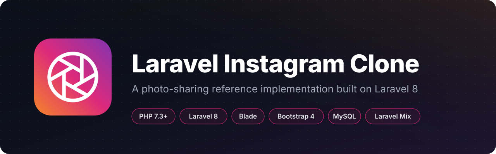
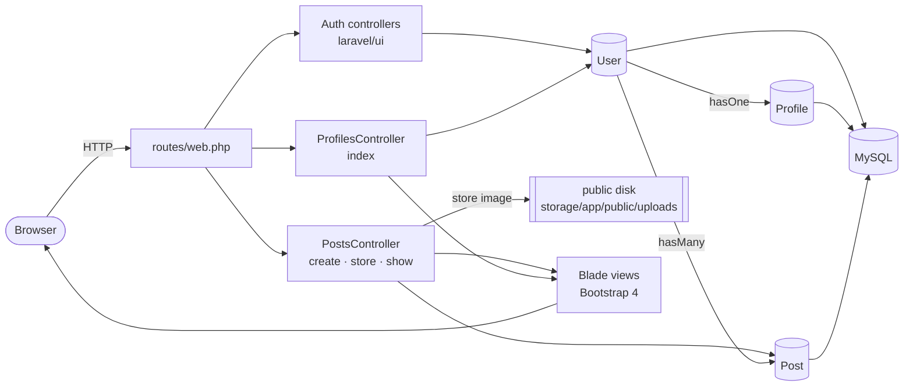

<div align="center">
  
  <p><b>A photo-sharing reference implementation built on Laravel 8: authentication, user profiles and image posts rendered with Blade and Bootstrap.</b></p>
  <p>
    
    
    
    
    <a href="LICENSE"></a>
    <a href="https://github.com/ismailbentabett/laravel-instagram-clone/stargazers"></a>
    
    
    
  </p>
  <p><a href="#-quick-start">Quick start</a> · <a href="#-features">Features</a> · <a href="#-architecture">Architecture</a> · <a href="#-contributing">Contributing</a></p>
</div>

> [!NOTE]
> **Laravel Instagram Clone is an independent learning project.** It is not affiliated with, endorsed by or sponsored by Instagram or Meta Platforms, Inc. "Instagram" is a trademark of its owner and is used here only to describe the kind of app being studied.

## Overview

**Laravel Instagram Clone** is a case study in building the core of a photo-sharing social app with classic server-rendered Laravel. Users register with a unique username, publish image posts with captions, and get a public profile page showing their bio and a grid of their posts. It demonstrates Eloquent relationships, authenticated resource routes, request validation, file uploads to the public disk and Blade layouts on top of the `laravel/ui` Bootstrap scaffolding.

## ✨ Features

| Feature | Description |
| --- | --- |
| **Authentication** | Register, log in, log out and password reset via `laravel/ui` (`Auth::routes()`). Registration requires a name, a **unique username**, an email and a confirmed password of at least 8 characters. |
| **Create posts** | Authenticated users upload an image with a caption at `/p/create`. Input is validated (`caption` required, `image` required and must be an image). |
| **Image storage** | Uploaded images are stored in `storage/app/public/uploads` on the `public` disk and served through the `storage` symlink. |
| **Post detail page** | Each post has its own page at `/p/{post}` showing the image, caption and author. |
| **Profile pages** | `/profile/{user}` shows the username, post count, profile title, description and URL, plus a grid of the user's posts (newest first). |
| **Eloquent relationships** | `User` has one `Profile` and has many `Post`; `Post` belongs to `User`, with route model binding on users and posts. |
| **Docker option** | A Laravel Sail `docker-compose.yml` with MySQL 8, Redis and MailHog services is included. |

## 🧱 Tech stack

| Layer | Technology |
| --- | --- |
| Language | PHP 7.3+ / 8.0 |
| Framework | [Laravel 8](https://laravel.com/docs/8.x) |
| Auth scaffolding | [laravel/ui 3](https://github.com/laravel/ui) (Bootstrap preset) |
| Views | Blade templates |
| Styling | Bootstrap 4, Sass |
| Front-end JS | Vue 2 (mounted via the laravel/ui preset; only the example component is registered) |
| Asset pipeline | Laravel Mix 5 (webpack) |
| Database | MySQL (via Eloquent ORM and migrations) |
| File storage | Laravel filesystem, `public` disk |
| Local environment | `php artisan serve` or Laravel Sail (Docker) |
| Testing | PHPUnit 9 |

## 🏗 Architecture



```text
app/
├── Http/Controllers/
│   ├── Auth/                # laravel/ui auth controllers
│   ├── PostsController.php  # create, store, show posts (auth middleware)
│   └── ProfilesController.php
└── Models/
    ├── User.php             # hasOne Profile, hasMany Post
    ├── Post.php             # belongsTo User
    └── profile.php          # Profile model
```

## 🚀 Quick start

### Prerequisites

- PHP 7.3+ or 8.0 with the extensions Laravel 8 requires
- Composer 2
- Node.js and npm (an LTS release compatible with Laravel Mix 5)
- MySQL 5.7+ or 8

### Install and run

```bash
git clone https://github.com/ismailbentabett/laravel-instagram-clone.git
cd laravel-instagram-clone

composer install
cp .env.example .env
php artisan key:generate

# create an empty MySQL database named instagram_clone, then:
php artisan migrate
php artisan storage:link

npm install && npm run dev
php artisan serve
```

Open <http://127.0.0.1:8000>, register an account, then visit `/p/create` to publish your first post.

### Create a profile row

Profiles are not created automatically on registration yet (see the [roadmap](#-roadmap)). Before opening `/profile/{id}`, add a profile for your user:

```bash
php artisan tinker
>>> DB::table('profiles')->insert(['user_id' => 1, 'title' => 'My profile', 'description' => 'Hello!', 'created_at' => now(), 'updated_at' => now()]);
```

### Optional: Laravel Sail (Docker)

The repository ships a Sail `docker-compose.yml`. After `composer install`, set `DB_HOST=mysql` in `.env` and run:

```bash
./vendor/bin/sail up -d
./vendor/bin/sail artisan migrate
```

## ⚙️ Configuration

All configuration lives in `.env` (copied from [`.env.example`](.env.example)). The variables that matter for this app:

| Variable | Default | Description |
| --- | --- | --- |
| `APP_NAME` | `Laravel` | Name shown in the navbar and page titles |
| `APP_ENV` | `local` | Environment name (`local`, `production`) |
| `APP_KEY` | *(empty)* | Generated by `php artisan key:generate` |
| `APP_DEBUG` | `true` | Detailed error pages; set to `false` in production |
| `APP_URL` | `http://localhost` | Base URL used for generated links and storage URLs |
| `DB_CONNECTION` | `mysql` | Database driver |
| `DB_HOST` | `127.0.0.1` | Database host (`mysql` when using Sail) |
| `DB_PORT` | `3306` | Database port |
| `DB_DATABASE` | `instagram_clone` | Database name |
| `DB_USERNAME` | `root` | Database user |
| `DB_PASSWORD` | *(empty)* | Database password |
| `MAIL_MAILER` / `MAIL_HOST` / `MAIL_PORT` | `smtp` / `mailhog` / `1025` | Mail transport used for password reset emails |

Never commit your `.env` file.

## 📁 Project structure

```text
laravel-instagram-clone/
├── app/                    # Controllers, models, providers
├── bootstrap/
├── config/                 # Laravel configuration
├── database/
│   ├── factories/
│   ├── migrations/         # users, profiles, posts, password resets, failed jobs
│   └── seeders/
├── public/                 # Web root (index.php, compiled assets)
├── resources/
│   ├── js/                 # Front-end entry (Axios, Vue 2 bootstrap)
│   ├── sass/               # Bootstrap 4 styles
│   └── views/              # Blade: layouts, auth, posts, profiles
├── routes/web.php          # Web routes
├── storage/                # Uploaded images (app/public/uploads), logs
├── tests/                  # PHPUnit feature and unit tests
├── docker-compose.yml      # Laravel Sail services
├── webpack.mix.js          # Laravel Mix build
└── .env.example
```

## 🗺 Roadmap

- [ ] Create a profile automatically when a user registers
- [ ] Add the missing `/home` route (the post-login redirect target) or point `RouteServiceProvider::HOME` to the profile page
- [ ] Rename `app/Models/profile.php` to `Profile.php` for case-sensitive (Linux) autoloading
- [ ] Profile editing and avatar uploads, replacing the placeholder avatar and follower counts
- [ ] Follow / unfollow and a feed of followed users' posts
- [ ] Image resizing on upload (Intervention Image is already a dependency)
- [ ] Remove the `/phpinfo` debug route
- [ ] Replace the navbar icon in `public/svg/` with the project's own logo
- [ ] Feature tests for auth, posts and profiles, plus a CI workflow

## 🤝 Contributing

Contributions are welcome. Read the [Contributing guide](CONTRIBUTING.md) for setup, commands and the pull request workflow, and follow the [Code of Conduct](CODE_OF_CONDUCT.md).

## 🔒 Security

Please report vulnerabilities privately through GitHub's Security tab. Details and deployment hardening notes are in [SECURITY.md](SECURITY.md).

## 📄 License

Released under the [MIT License](LICENSE).

---

<div align="center">
  <p>Built by <a href="https://github.com/ismailbentabett">Ismail Bentabett</a> · <a href="https://ismailbentabett.com">ismailbentabett.com</a></p>
  <p>⭐ Star this repo if you find it useful</p>
</div>
